# Tutorial: mockups with Claude Code in the cloud

This tutorial takes you from nothing to a small set of clickable mockups, built from a design system, published
as a page you can share. You work in a Claude Code session in the cloud, so you need nothing on your own computer
but the Claude desktop app (or a browser) and a GitHub account.

On the way you use each skill in the `kheel-mockup` plugin:

| Step | What you do | Skill |
| --- | --- | --- |
| [1](#1-create-a-repository) | Create a repository to hold the mockups | — |
| [2](#2-add-the-plugin) | Add the plugin in the Claude desktop app | — |
| [3](#3-start-a-cloud-session) | Start a Claude Code session in the cloud | — |
| [4](#4-set-up-the-project-space) | Set up the project space with the starter design system | `mockup-init` |
| [5](#5-compare-options-with-mockup-explore) | Compare layouts for a screen and pick one | `mockup-explore` |
| [6](#6-create-mockups-with-mockup-create) | Create the screens, their states and a dialog | `mockup-create` |
| [7](#7-publish-with-mockup-publish) | Publish them as a private page | `mockup-publish` |
| [8](#8-add-a-component-of-your-own) | Add a component of your own to the design system | `mockup-create` |

The example throughout is **Shelf**, a small app for lending books around an office: what's on the shelf, who has
what, and what's overdue. The prompts below are the ones to type; the screenshots show what came back. Claude
won't produce exactly the same screens for you, and that's fine: the steps are the same.

> **Allow about 45 minutes.** Each step builds on the one before, but you can stop after any of them.

## Before you start

You need:

- the **Claude desktop app** (or [claude.ai](https://claude.ai) in a browser), on a plan that includes Claude Code
  on the web;
- a **GitHub account**, connected to Claude, with the [Claude GitHub app](https://github.com/apps/claude)
  allowed on the repository you'll use (step 1).

## 1. Create a repository

Mockups live in a repository like any other files: Claude writes them there, checks them, and commits them. If you
already have a repository you'd like to mock up screens for, use it and skip to step 2. The mockups go in a
folder of their own and won't touch anything else.

Otherwise, create a trivial one:

1. On GitHub, choose **New repository**.
2. Name it `shelf`, make it private if you like, and tick **Add a README file**, so it isn't empty.
3. Choose **Create repository**.
4. Make sure the Claude GitHub app can reach it: on <https://github.com/apps/claude>, choose **Configure**, then
   add `shelf` to the repositories it may access (or allow all repositories).

That's all the repository needs. When you're done it will look like this:

```
shelf/
├── README.md
└── mockups/              ← added by the skills in the steps below
    ├── design-system/
    ├── examples/
    └── shelf/
```

## 2. Add the plugin

The skills come as a plugin, `kheel-mockup`, listed in Kheel's plugin marketplace, `kheel-skills`. You add the
marketplace once, then install the plugin from it. Plugins you add here are available to your Claude Code
sessions in the cloud too.

1. Open the Claude desktop app and stay in **Claude** (the chat side, not **Code**).
2. Open **Customize**, then **Plugins**.
3. Add a marketplace: enter `kheelco/kheel-skills` (or its address, `https://github.com/kheelco/kheel-skills`).
4. In the `kheel-skills` marketplace, find **kheel-mockup** ("Agent skills for creating and maintaining
   design-system-bound mockups") and install it.

The marketplace also lists `kheel-analysis` (requirements analysis); you don't need it for this tutorial.

> Install `kheel-mockup` from one marketplace only. The kheel-mockups repository is a marketplace of its own as
> well (`kheel-mockup@kheel-mockup`); installing from both makes every skill appear twice.

The plugin brings five skills:

| Skill | Use it to |
| --- | --- |
| `mockup-init` | set up a folder as a mockup project space, with a starter design system or empty |
| `mockup-init-jui` | do the same with a design system of standard [JUI](https://github.com/juiproject/jui-stack) components |
| `mockup-explore` | see options for one design decision side by side, and pick one |
| `mockup-create` | create or revise a mockup (a page, a section or a dialog) from the design system |
| `mockup-publish` | publish mockups as a private claude.ai page you can share |

You don't call them by name: ask for what you want ("set up mockups", "show me options", "mock up a screen",
"publish the mockups") and Claude picks the skill. You can name one if you want to be sure.

## 3. Start a cloud session

1. In the desktop app, switch to **Code**.
2. Start a new session that runs **in the cloud** (not on your computer), and choose the `shelf` repository (or
   your own). The default environment is fine: it can install packages, and it has a browser and Playwright
   installed, which the skills use to check mockups and take screenshots.
3. When the session is ready, check that the skills are there:

   > Which mockup skills do you have?

   Claude should list the five skills above. If it doesn't, check the plugin is installed (step 2) and start a new
   session.

**Seeing your mockups from the cloud.** A cloud session runs on a machine of its own, so you can't open a local
server's page the way you would on your computer. You have three ways to look at your work, all used below:

- ask Claude to **send you screenshots**; it takes them anyway when it checks the mockups;
- **publish** them (step 7) and open the link;
- **pull the branch** to your computer and serve it there (`python3 -m http.server 8000` in `mockups/`, then
  open <http://localhost:8000/design-system/>), or open it in VS Code with the
  [Kheel Mockup Preview](../extensions/vscode/README.md) extension.

Claude works on a branch of its own in the cloud. Ask it to **commit and push** whenever you want to keep what it
has done, and to open a pull request when you want it in your main branch.

## 4. Set up the project space

A **project space** is any folder of mockups. It has a `design-system/` folder at its root, holding the design
system the mockups are built from and the viewer that draws them in a browser, with no build step.

Ask:

> Set up mockups in a folder called `mockups`, with the starter design system and its examples.

Claude uses **`mockup-init`**. It copies three things into `mockups/`, never overwriting anything that's already
there:

```
mockups/
├── design-system/
│   ├── README.md          ← the manifest: every token file, component, pattern and icon
│   ├── tokens.md          ← colour, type, spacing, radius, elevation
│   ├── behaviours.md      ← shared behaviours: validation, filtering, sorting
│   ├── components/        ← 23 components, ui-button.md to ui-shell.md, one markdown file each
│   ├── patterns/          ← data table, card gallery
│   ├── assets/icons/      ← 48 Lucide icons
│   ├── index.html         ┐
│   ├── _runtime.js        ├ the viewer and its guide: part of the mechanism, not your design system
│   └── _guide.md          ┘
└── examples/              ← example mockups for a field-service app, to learn from and delete later
```

The **starter** design system is small and neutral on purpose: a grey-and-blue look that keeps attention on
structure. It is yours: change its tokens and components as your product needs (step 8 adds one). For a JUI
application, ask for the JUI design system instead, which uses `mockup-init-jui`; for a design system you'll bring
in from elsewhere, ask for an **empty** project space.

Ask Claude to show you what it set up:

> Check the catalogue and the examples, and send me screenshots of the catalogue and the Jobs example.

The **catalogue** (`design-system/index.html`) lists every mockup in the project space, by folder, and then
every component with its live examples. The bar at the top shows the design system's name and version, and the
number of warnings: problems the viewer found, such as an unknown component or a missing link target. It should
read **0 warnings**.

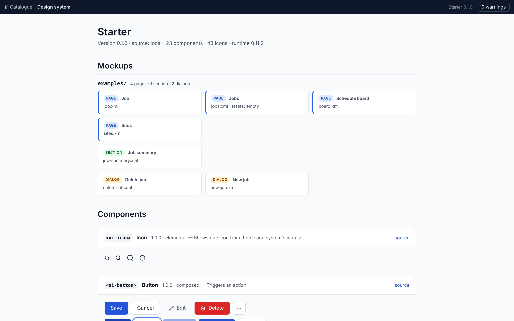

Each example is an XML file. Here is part of `examples/jobs.xml`:

```xml
<mockup type="page" title="Jobs" design-system="0.1.0" states="empty">
  <specification>
    Every job the signed-in dispatcher can see, soonest due first. Follows the **Data table** pattern.
  </specification>

  <ui-shell product="Fieldwork" user="Mere Tipene">
    <ui-nav> … </ui-nav>
    <ui-panel title="Jobs" description="12 open · 3 overdue" padding="none">
      <ui-button slot="actions" variant="primary" icon="plus" label="New job" opens="new-job.xml"/>
      <ui-table caption="Jobs"> … </ui-table>
    </ui-panel>
  </ui-shell>
</mockup>
```

and here is how the viewer draws it:

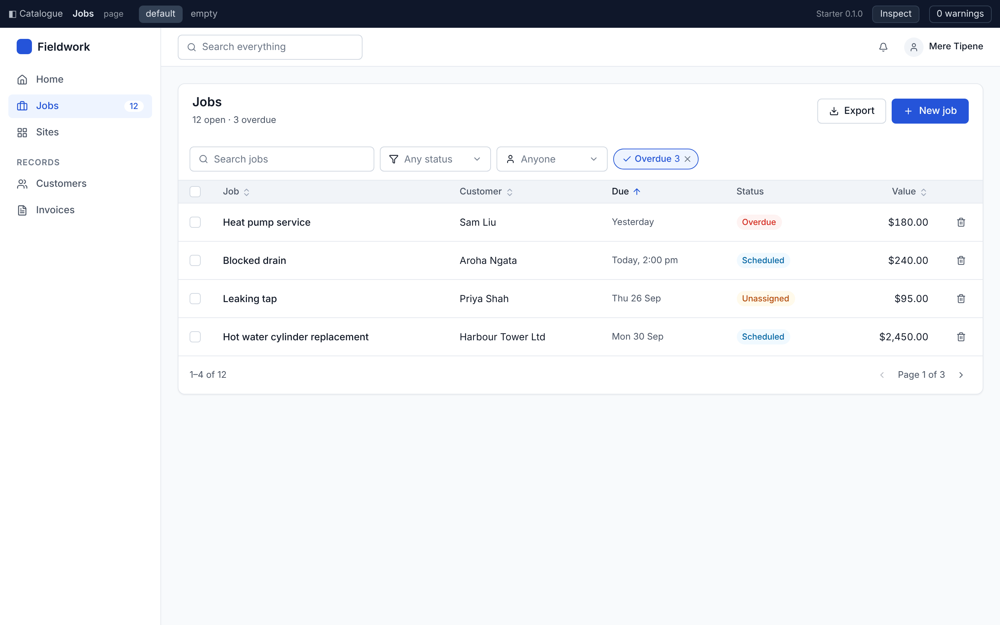

Everything on it is a component from the design system (`ui-shell`, `ui-panel`, `ui-table`, `ui-badge`), so every
screen made this way looks and behaves the same. The `default` and `empty` tabs in the bar are the page's
**states**: `jobs.empty.xml` is the same page with nothing in it.

Ask Claude to commit and push before going on.

## 5. Compare options with mockup-explore

Some decisions are easier to make by looking. Before building Shelf's main page, decide how it should list the
library.

> I'm building Shelf, an app for lending books around the office. Before we mock up the Books page, show me
> options for how it should list the library: a table, cards, or grouped by status. Members borrow books;
> librarians can also add books and mark them returned.

Claude uses **`mockup-explore`**. It reads the design system's tokens and components and builds **one HTML page**
with three to six distinct options for that one decision, each drawn **in place**: a slice of the real screen,
with the app's navigation and header around it and real content in it, so you judge it in context rather than in
isolation. Things that aren't the decision but change what you see, such as who is looking, become **switches**
at the top that apply to every option.

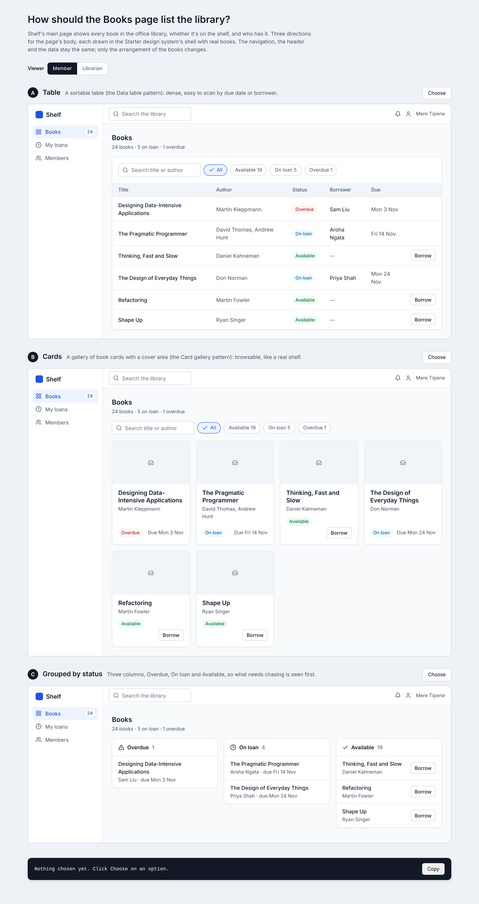

The page is a working file, saved in a folder whose name starts with `_` (here `mockups/_explore/`), which the
viewer doesn't list. Claude publishes it for you as a private page if it can, and otherwise sends a screenshot.

Flip the switch to **Librarian** and the options gain *Add book*, *Lend* and *Mark returned*. Choose an option,
and the bar at the bottom sums up your choice, ready to copy back to Claude:

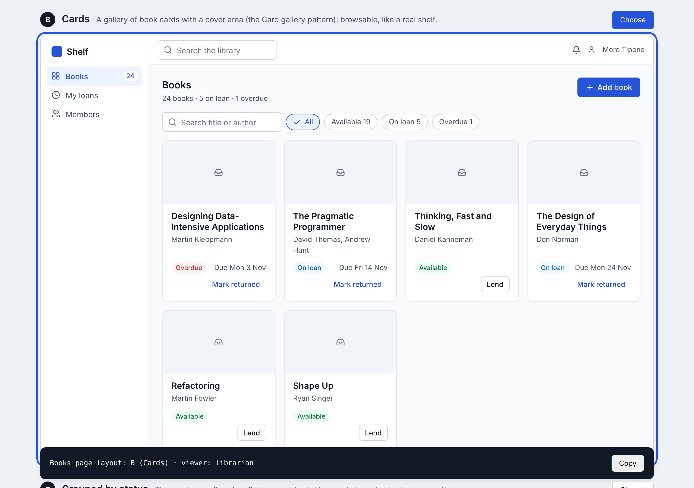

Reply with the summary line and any changes:

> Books page layout: B (Cards). Show the member's view.

When the decision changes something that already exists (a header, a table's cells), `mockup-explore` also
applies the choice: to the component's file in the design system, or as an *extension* for a component you
don't own, and to the mockups that show it. Here there is no Books page yet, so the choice carries into the next
step.

## 6. Create mockups with mockup-create

> Create the Books page using option B. Add an empty state for a new library, a page for one book with its loan
> history, a Borrow dialog, and a My loans page. Put them in `mockups/shelf`.

Claude uses **`mockup-create`**. It reads the manifest, the files of the components it will use, and the pattern
that fits (here **Card gallery**), then writes the mockups:

```
mockups/shelf/
├── _frame/
│   ├── nav-books.xml      ← the navigation, shared by every page through <include>
│   └── nav-my-loans.xml
├── books.xml              ← the Books page (option B), states="empty"
├── books.empty.xml        ← the same page with no books yet
├── book.xml               ← one book and its loan history
├── borrow-book.xml        ← a dialog, opened from Borrow
└── my-loans.xml           ← the member's loans
```

A few rules it follows, which you'll see in the files:

- **Components first.** Anything the design system has a component for is that component, never hand-made
  HTML. Layout comes from attributes (`layout="row" gap="2"`), not CSS.
- **Variants are choices, states are conditions.** *Overdue* is a `danger` badge everywhere; a whole-screen state
  is a file of its own (`books.empty.xml`), shown as a tab.
- **Shared parts are included, not copied.** The navigation is a `section` in `_frame/` (folders starting with
  `_` aren't listed in the catalogue), so changing it once changes every page.
- **Specifications carry meaning.** Every mockup starts with a `<specification>`, and `spec="…"` on an element
  says what the picture can't: where data comes from, what an action does, who sees what.

Here is the start of `books.xml`:

```xml
<mockup type="page" title="Books" design-system="0.1.0" states="empty">
  <specification>
    Every book in the office library, as a gallery of cards (option B from the layout exploration). Follows the
    **Card gallery** pattern and the shared **Filtering** behaviour. Shown to a member; librarians also see
    **Add book**.
  </specification>

  <ui-shell product="Shelf" user="Mere Tipene">
    <include src="_frame/nav-books.xml"/>
    <ui-panel variant="plain" title="Books" description="24 books · 5 on loan · 1 overdue">
      <ui-button slot="actions" variant="primary" icon="plus" label="Add book" spec="Librarians only."/>
      …
      <ui-grid min="small">
        <ui-card title="Thinking, Fast and Slow" subtitle="Daniel Kahneman" media="placeholder" href="book.xml">
          <ui-badge tone="success" label="Available"/>
          <span>On the shelf</span>
          <ui-button size="small" label="Borrow" opens="borrow-book.xml"/>
        </ui-card>
        …
```

Then it **checks** them. The skill carries a script that serves the project space, opens every mockup (and every
state file) in a browser, waits until the viewer has drawn it, prints its warnings and takes a screenshot:

```
node <mockup-create>/scripts/mockup-check.mjs --root mockups --shots <scratch folder> shelf

  0 warnings  shelf/book.xml
  0 warnings  shelf/books.empty.xml
  0 warnings  shelf/books.xml
  0 warnings  shelf/borrow-book.xml
  0 warnings  shelf/my-loans.xml

5 pages, 0 warnings
```

Claude fixes any warning and runs it again until it's clean, then looks at the screenshots, because warnings
check structure, not appearance. Ask to see them:

> Send me the screenshots: the Books page, the page with the Borrow dialog open, the empty state, and Inspect mode.

**The Books page.** Cards link to the book's page; **Borrow** opens the dialog.

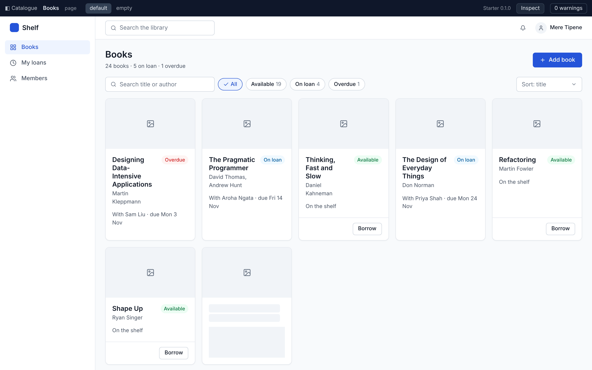

**The Borrow dialog**, opened over the page. In the viewer, clicking **Borrow** opens it, and **Cancel**, the
scrim or Escape close it; **Borrow** in the dialog goes on to My loans, so you can click through the flow.

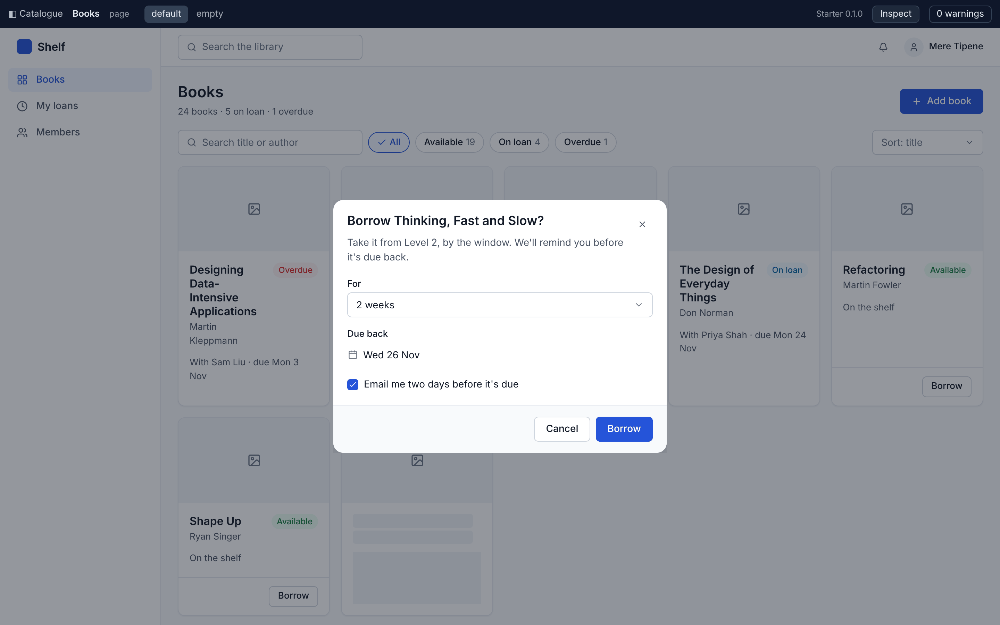

**The empty state**, on the **empty** tab: what a new library sees.

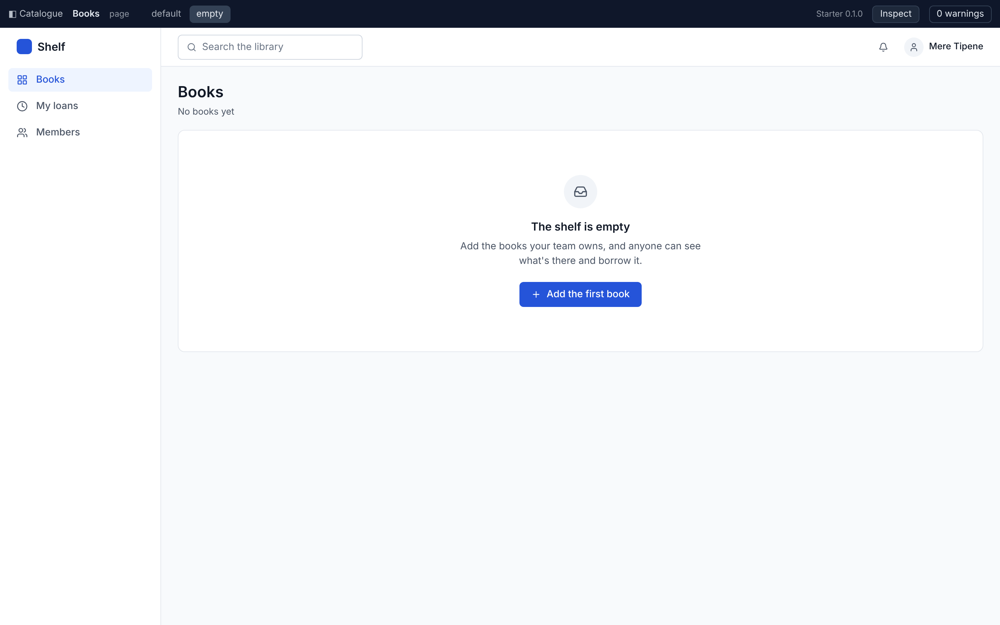

**Inspect mode** (the **Inspect** button) numbers every element that carries a specification and lists them
beside the page, with the mockup's own specification at the top, any custom regions and any warnings. This is
what a developer implementing the screen reads.

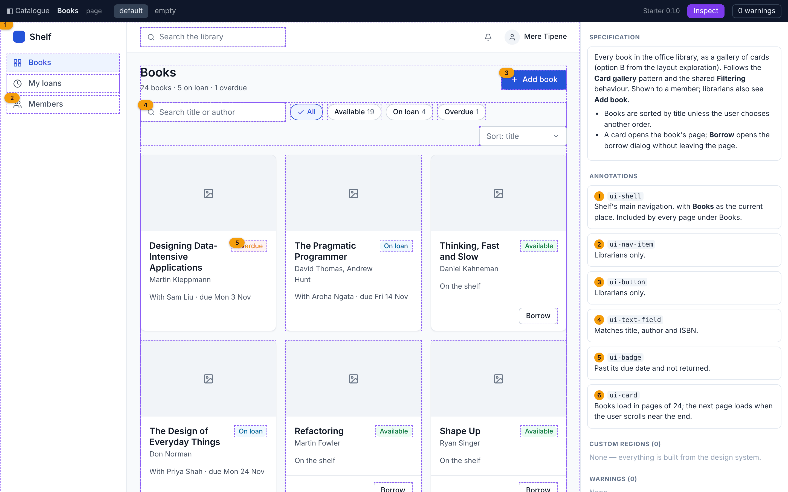

**The book's page**, reached from a card:


The catalogue now lists the new folder beside the examples:

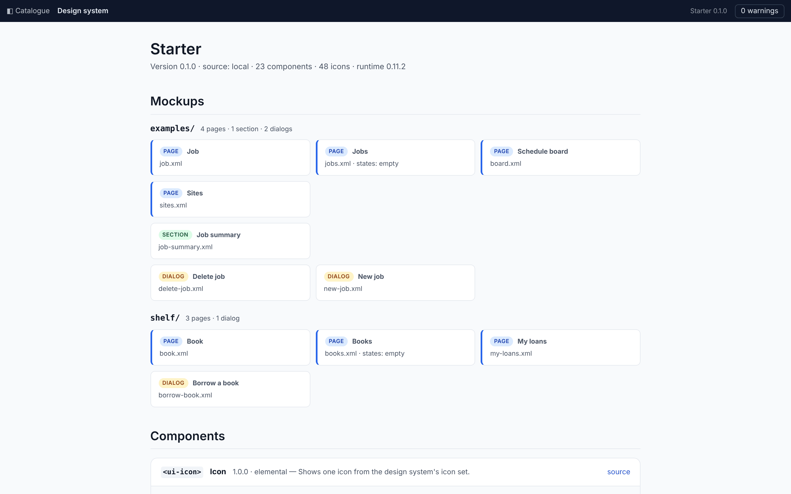

To change a screen, just say so: "Put the filters above the title", "Add a *Reserve* button for books on loan".
Claude revises the mockup, keeps what was right, and checks it again. Commit and push when you're happy.

## 7. Publish with mockup-publish

Screenshots are fine for you; for your team, publish.

> Publish the mockups in `shelf`.

Claude uses **`mockup-publish`**. An artifact holds at most 255 files and the design system alone is more than
half of that, so the skill's script stages a copy: the viewer, the whole design system packed into one
`_bundle.json`, the folder you named, and anything its mockups need from elsewhere (included sections, dialogs,
state files, images):

```
python3 <mockup-publish>/scripts/mockup-bundle.py --stage <scratch>/mockups-shelf --ds mockups/design-system shelf

…/mockups-shelf/design-system/_bundle.json: 74 files, 142 KB
…/mockups-shelf: 10 files (index.html, the runtime, the bundle, 7 project files); 5 mockups listed
```

It publishes that as a **private claude.ai artifact** and gives you the link. It's private until you share it;
anyone you share it with sees the mockups without installing anything. Claude also records it in
`mockups/PUBLISHED.md`, so the next publish updates the same page instead of making a new one:

```markdown
| Mockups | Folders | Artifact |
| --- | --- | --- |
| Shelf | shelf | https://claude.ai/… |
```

The published page is the same viewer: the catalogue lists the folders you published (the examples aren't
included, because you didn't name them), followed by the design system's components.

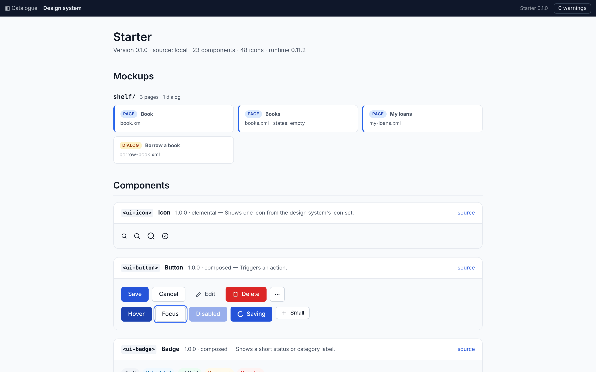

Mockups open from the catalogue, or directly with `?m=shelf/books.xml` added to the page's address. Links,
dialogs, state tabs and Inspect all work as they do locally.

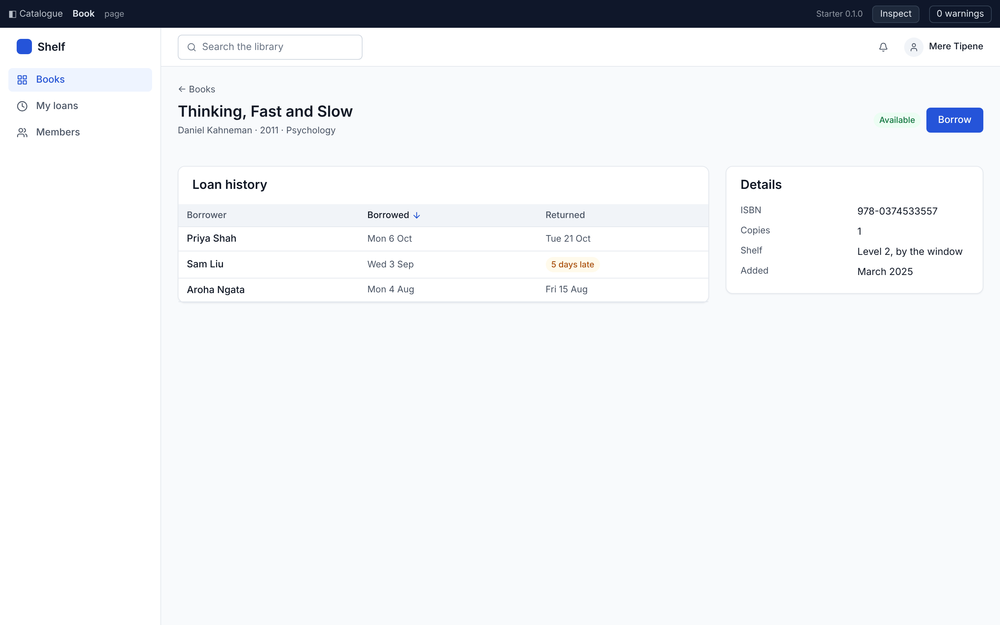

The script only follows what a mockup can't work without. A plain link to a mockup outside the folders you named
is reported instead of followed, and warns "no such mockup" on the published page; ask Claude to publish with
`--follow-links` if you want those mockups too. Commit `PUBLISHED.md` with everything else.

## 8. Add a component of your own

The design system won't have everything your product needs. The grey image placeholders on Shelf's cards are a
case in point: Shelf has no cover images, and the cards look empty. You have three ways to fill a gap, and the
skills pick between them by these rules:

| When | Do this |
| --- | --- |
| The piece is reusable and the design system is yours (the starter's `ui-` components) | Add a **component** to `design-system/components/`, or change an existing one. |
| The component isn't yours: it mirrors a library or another design system, such as JUI's `jui-` components | Never edit it. Add an **extension**, `design-system/extensions/<tag>.md`, with the variants you need. |
| It's a one-off the design system can't express, such as a draggable board or a diagram | Build it in the mockup as a **custom region**: HTML and CSS using the design system's tokens, marked `custom="<what it is and why>"`. |

A drawn book cover will appear on cards, on the book's page and in lists, so it's a component.

> The cards' grey placeholders look empty. Add a book cover component to the design system: a coloured cover
> with the title and author, in a few colours, with a small size for lists. Use it on the Books page and in My
> loans.

Claude uses **`mockup-create`**, following its rules for changing the design system. It writes
`design-system/components/ui-book-cover.md`, in the same format as every other component: its purpose,
properties, variants, states, rules of use, the tokens it uses, an HTML template, its CSS and an example.

```markdown
---
name: ui-book-cover
version: 1.0.0
kind: elemental
status: active
summary: A drawn cover for a book that has no cover image, showing its title and author.
---

# Book cover

## Properties

| Property | Controls | Values | Default | Description |
| --- | --- | --- | --- | --- |
| title | content | text | | The book's title. |
| author | content | text | | The author or authors. |
| colour | variant | navy, forest, ochre, berry, slate | navy | The cover's colour. |
| size | variant | fill, small | fill | `fill` fills its container (a card's media area); `small` is a 48 × 64 px thumbnail. |

## Rules of use

- Don't use the colour to mean anything (status, genre). Status is a `ui-badge`.
- Don't use it when a real cover image exists.

## Template

    <div class="cover" aria-hidden="true">
      <span class="title">{{title}}</span>
      <span class="author" data-if="author">{{author}}</span>
    </div>

…
```

It lists the component in the manifest, `design-system/README.md`, and moves the design system's version from
0.1.0 to **0.2.0**, since adding a component is a minor change. The mockups it updates record the version they
were checked against (`design-system="0.2.0"`).

Then it checks the catalogue as well as the mockups (`mockup-check.mjs --catalogue`), because the viewer checks
component files too. It caught two mistakes in the first draft of this one: a token the style used that the
component's Tokens table didn't list, and one the table listed that the style didn't use.

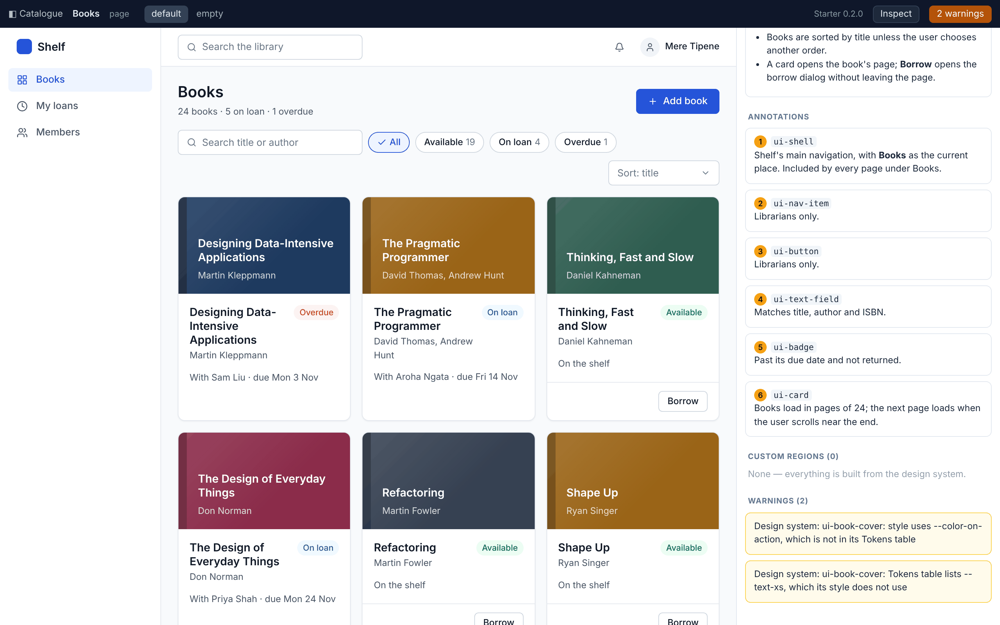

Claude fixes them and runs the check again until it reads **0 warnings**. The new component appears in the
catalogue with its example, like any other:

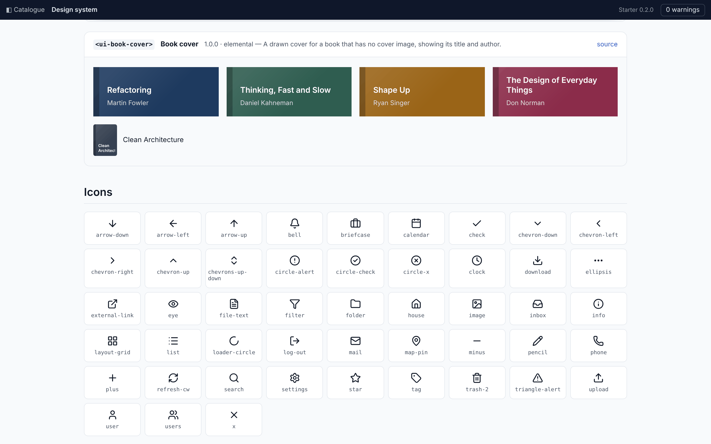

And on the Books page, each card now has a cover:

```xml
<ui-card title="Thinking, Fast and Slow" subtitle="Daniel Kahneman" href="book.xml">
  <ui-book-cover slot="media" colour="forest" title="Thinking, Fast and Slow" author="Daniel Kahneman"/>
  <ui-badge tone="success" label="Available"/>
  …
```

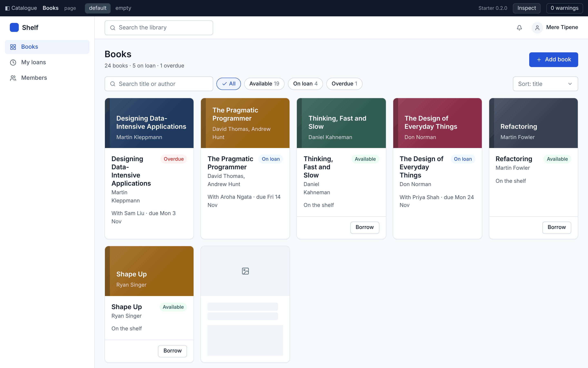

The small size sits beside a title in My loans:

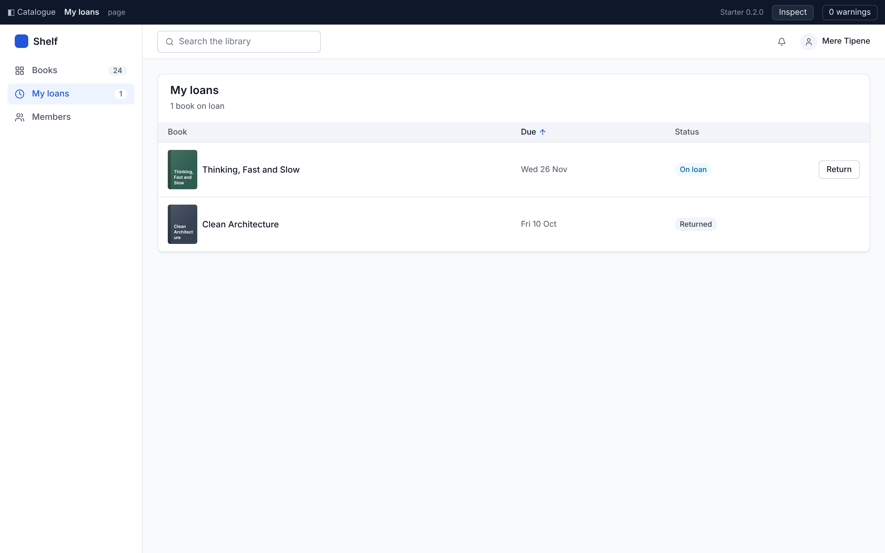

Finally, update the published page, so your team sees the covers:

> Republish the Shelf mockups.

Claude finds the artifact in `PUBLISHED.md`, stages the folder again (the bundle is a snapshot, so it's always
re-staged after the design system changes) and updates the same link. Commit and push.

## What's next

- **Mock up your own product.** Delete `mockups/examples/` once you've learnt from it, and start from your own
  screens: describe them, paste a specification, or attach a sketch.
- **Make the design system yours.** Ask Claude to change the tokens to your brand's colours and type; every
  component and mockup follows.
- **Use the JUI design system** for a JUI application: ask to set up a project space with JUI (`mockup-init-jui`).
- **Preview locally** in VS Code with the [Kheel Mockup Preview](../extensions/vscode/README.md) extension, which
  shows the mockup beside the editor and reloads it as files change.
- **Implement from the mockups.** They're built to be read by an agent: components with known names, and
  specifications for everything the picture can't say. Point Claude at a mockup and its design system and ask it
  to build the screen.

The full mockup format is in `mockups/design-system/_guide.md` in your project space.
